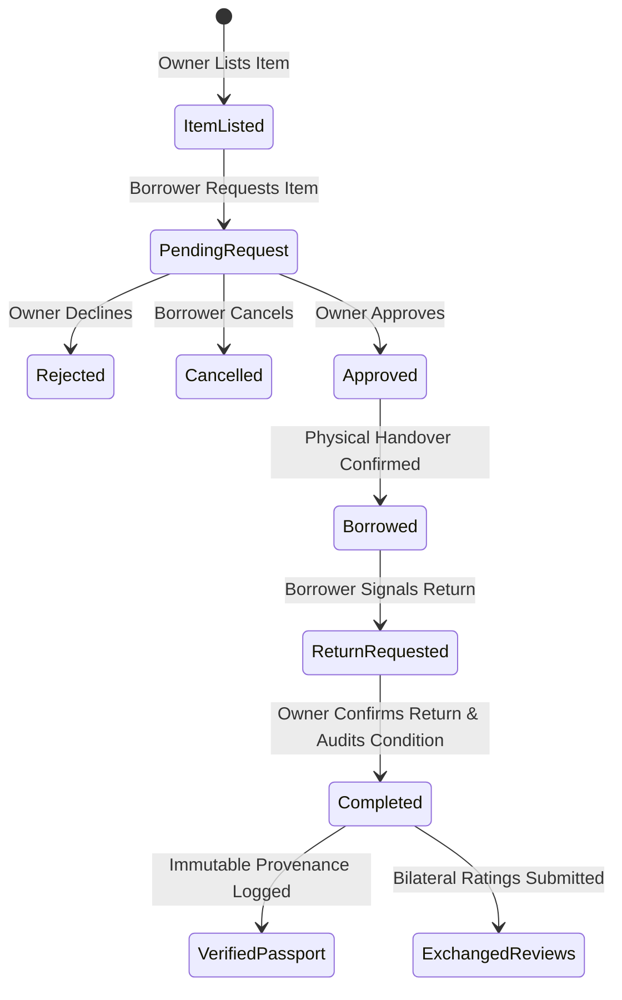

# BorrowBuddy — "Borrow More. Buy Less."

A modern, production-grade community item borrowing and lending platform built with the MERN stack (MongoDB, Express.js, React.js, Node.js, Tailwind CSS). BorrowBuddy connects college students, hostel residents, PG tenants, and local neighborhoods to share occasionally used tools, camping gear, electronics, sports equipment, and books safely and transparently with an immutable **Borrowing Passport** and community trust engine.

---

## 📖 Table of Contents
1. [Project Overview & Problem Statement](#project-overview--problem-statement)
2. [Key Features](#key-features)
3. [Technology Stack](#technology-stack)
4. [System Architecture](#system-architecture)
5. [Database Schema & Models](#database-schema--models)
6. [REST API Documentation](#rest-api-documentation)
7. [Installation & Setup](#installation--setup)
8. [Environment Variables](#environment-variables)
9. [Demo Accounts & Credentials](#demo-accounts--credentials)
10. [End-to-End Workflow & Borrowing Passport](#end-to-end-workflow--borrowing-passport)
11. [Testing & Verification](#testing--verification)
12. [Deployment Guide](#deployment-guide)

---

## 1. Project Overview & Problem Statement

### The Real-World Problem
Most household and specialized items (such as drills, ladders, camping tents, projectors, and pressure washers) are purchased at full retail price even when only needed once or twice a year. An electric drill machine is used on average for only **13 minutes in its entire lifespan**, yet costs thousands of rupees. Simultaneously, neighbors, hostel peers, and fellow PG residents often own these exact tools sitting idle in closets.

### The Solution: BorrowBuddy
BorrowBuddy creates a hyperlocal circular economy where users can discover, borrow, lend, and return items within their immediate community with:
- **Zero-Waste Economics**: Save up to 90% over retail purchasing.
- **Verifiable Borrowing Passports**: Digital provenance tracking listing dates, total borrows, on-time return percentages, and damage reports.
- **Two-Way Trust Ratings**: Both borrowers and owners leave bilateral reviews after each completed borrow.
- **Hyperlocal Campus & City Hubs**: Initial rollout targeted at **Phagwara (LPU area)**, **Jalandhar (Model Town)**, **Ludhiana (Sarabha Nagar)**, **Kangra (Dharamshala road)**, and **Chandigarh (PU Campus / Sector 17)**.

---

## 2. Key Features

### 🌟 Landing Page & Discovery
- **Hero & Search Engine**: Real-time keyword search, category filter, and city hub selector.
- **Dynamic Database Metrics**: Real calculated database counts (active items, members, completed borrows, and city nodes).
- **Featured Community Items**: Grid of popular items with direct access to item details and passports.
- **4-Step How It Works**: Transparent educational breakdown of the borrowing lifecycle.

### 🛡️ Authentication & Profiles
- **Secure JWT Auth**: 30-day encrypted JWT tokens with bcrypt password hashing (10 salt rounds).
- **Public Profile Pages**: View any member's active listings, verified rating, total reviews, and member tenure.
- **1-Click Quick Demo Switcher**: Instant evaluation access as any of the 5 seeded persona accounts.

### 📦 Item Catalog & Management
- **8 Diverse Categories**: Electronics, Books, Sports, Tools, Furniture, Travel & Camping, Kitchen, Other.
- **Flexible Pricing**: Support for 100% Free community lending or daily rental rates (₹/day) plus optional refundable security deposits.
- **Condition Grading**: Clear condition flags (New, Like New, Good, Fair).
- **Multi-Photo Upload**: Dual support for local file uploads (Multer) or image URLs with live card preview.

### 🤝 The Core Borrowing Lifecycle
1. **Discovery**: Borrower selects an item and picks requested date range.
2. **Conflict Prevention**: System enforces date collision checks against already approved periods.
3. **Owner Review**: Owner approves or declines incoming requests.
4. **Transaction Agreement**: Approved requests transition into active transaction records.
5. **Two-Party Handover**: Physical handover is recorded (`Approved` → `Borrowed`).
6. **Return Signal**: Borrower signals completion (`Borrowed` → `Return Requested`).
7. **Condition Audit & Return Confirmation**: Owner confirms receipt and logs damages if any (`Return Requested` → `Completed`).

### 🛂 Borrowing Passport
A tamper-proof provenance ledger for every listed item that computes:
- Item original condition & listing date
- Total verified borrow transactions
- On-time return rate percentage
- Clean record or reported damage incidents
- Calculated trust score (out of 100) & Community Verification Seal
- Chronological timeline of all past completed borrows with borrower names and dates

### ⭐ Two-Way Reviews & Ratings
- Post-completion rating (1 to 5 stars) + written feedback.
- Quick compliment badges (*"Punctual Handover"*, *"Item in Mint Condition"*, *"Super Clean"*).
- Prevents duplicate reviews for the same transaction and automatically recalculates user average rating.

---

## 3. Technology Stack

| Layer | Technologies Used |
| :--- | :--- |
| **Frontend** | React 19, Vite, Tailwind CSS v3, React Router DOM v7, Axios, Lucide React, React Hot Toast |
| **Backend** | Node.js (v22), Express.js (v4), REST API architecture |
| **Database** | MongoDB with Mongoose ODM (v8) |
| **Authentication** | JSON Web Tokens (`jsonwebtoken`), `bcryptjs`, Express Rate Limiter |
| **File Storage** | Multer for local disk storage with web fallback URLs |

---

## 4. System Architecture

```
                  ┌─────────────────────────────────────────┐
                  │           React + Vite Client           │
                  │   Tailwind CSS / Lucide / Hot Toast     │
                  └────────────────────┬────────────────────┘
                                       │ Axios HTTP + JWT
                                       ▼
                  ┌─────────────────────────────────────────┐
                  │           Express.js REST API           │
                  │  Rate Limiting, Multer, JWT Middleware  │
                  └────────────────────┬────────────────────┘
                                       │ Mongoose ODM
                                       ▼
                  ┌─────────────────────────────────────────┐
                  │            MongoDB Database             │
                  │   Users, Items, Requests, Transactions, │
                  │            Reviews, Passports           │
                  └─────────────────────────────────────────┘
```

---

## 5. Database Schema & Models

### 1. User Model (`server/models/User.js`)
- `name` (String, required)
- `email` (String, required, unique, lowercase)
- `password` (String, required, hashed with bcrypt)
- `phone` (String, required)
- `city` (String, required)
- `locality` (String, required)
- `avatar` (String)
- `bio` (String)
- `rating` (Number, default 5.0)
- `totalReviews` (Number, default 0)
- `role` (enum: `['user', 'admin']`)

### 2. Item Model (`server/models/Item.js`)
- `title`, `description`, `category`, `condition`
- `images` ([String], required)
- `owner` (ObjectId ref User)
- `city`, `locality`
- `pricePerDay` (Number, 0 = Free)
- `securityDeposit` (Number)
- `borrowingRules` (String)
- `isAvailable` (Boolean)
- `totalBorrows` (Number)
- `damageReportsCount` (Number)

### 3. BorrowRequest Model (`server/models/BorrowRequest.js`)
- `item` (ObjectId ref Item)
- `borrower` (ObjectId ref User)
- `owner` (ObjectId ref User)
- `startDate` (Date), `endDate` (Date), `totalDays` (Number)
- `estimatedPrice` (Number)
- `message` (String)
- `status` (enum: `['Pending', 'Approved', 'Rejected', 'Cancelled']`)
- `rejectionReason` (String)

### 4. Transaction Model (`server/models/Transaction.js`)
- `request` (ObjectId ref BorrowRequest, unique)
- `item`, `borrower`, `owner`
- `startDate`, `endDate`
- `status` (enum: `['Approved', 'Borrowed', 'Return Requested', 'Completed']`)
- `handoverDate` (Date), `handoverConfirmedByOwner` / `handoverConfirmedByBorrower` (Boolean)
- `actualReturnDate` (Date), `isReturnedOnTime` (Boolean)
- `damageReported` (Boolean), `damageNotes` (String)

### 5. Review Model (`server/models/Review.js`)
- `transaction` (ObjectId ref Transaction)
- `item` (ObjectId ref Item)
- `reviewer` (ObjectId ref User), `reviewee` (ObjectId ref User)
- `role` (enum: `['borrower_to_owner', 'owner_to_borrower']`)
- `rating` (Number, 1 to 5)
- `comment` (String)
- `tags` ([String])
- Compound Index: `{ transaction: 1, reviewer: 1 }` (Enforces 1 review per user per transaction)

---

## 6. REST API Documentation

### Authentication
| Method | Endpoint | Access | Description |
| :--- | :--- | :--- | :--- |
| `POST` | `/api/auth/register` | Public | Register new member account |
| `POST` | `/api/auth/login` | Public | Authenticate user & return JWT token |
| `GET` | `/api/auth/me` | Protected | Get authenticated user profile |

### Items & Borrowing Passport
| Method | Endpoint | Access | Description |
| :--- | :--- | :--- | :--- |
| `GET` | `/api/items` | Public | Query items with search, category, condition, location filters |
| `GET` | `/api/items/featured` | Public | Top popular items for homepage |
| `GET` | `/api/items/my` | Protected | Items owned by logged in user |
| `GET` | `/api/items/:id` | Public | Detailed item information |
| `GET` | `/api/items/:id/passport` | Public | Verified Borrowing Passport ledger & provenance |
| `POST` | `/api/items` | Protected | List a new item (supports multipart file uploads) |
| `PUT` | `/api/items/:id` | Protected | Edit item (Owner only) |
| `DELETE`| `/api/items/:id` | Protected | Remove item (Owner only) |

### Borrow Requests
| Method | Endpoint | Access | Description |
| :--- | :--- | :--- | :--- |
| `POST` | `/api/requests` | Protected | Create borrow request (checks owner and date overlap) |
| `GET` | `/api/requests/sent` | Protected | Requests sent by current user |
| `GET` | `/api/requests/received` | Protected | Inquiries on items owned by current user |
| `PUT` | `/api/requests/:id/approve` | Protected | Owner approves request (creates Transaction) |
| `PUT` | `/api/requests/:id/reject` | Protected | Owner declines request |
| `PUT` | `/api/requests/:id/cancel` | Protected | Borrower cancels pending request |

### Transactions
| Method | Endpoint | Access | Description |
| :--- | :--- | :--- | :--- |
| `GET` | `/api/transactions` | Protected | Active & completed transactions for user |
| `GET` | `/api/transactions/:id` | Protected | Detailed transaction with audit record |
| `PUT` | `/api/transactions/:id/handover` | Protected | Confirm item handover (`Approved` → `Borrowed`) |
| `PUT` | `/api/transactions/:id/return` | Protected | Signal item return (`Borrowed` → `Return Requested`) |
| `PUT` | `/api/transactions/:id/confirm-return` | Protected | Owner confirms return (`Completed`, damage audit) |

### Reviews & Stats
| Method | Endpoint | Access | Description |
| :--- | :--- | :--- | :--- |
| `POST` | `/api/reviews` | Protected | Submit rating, comment & tags for completed transaction |
| `GET` | `/api/reviews/user/:userId` | Public | Reviews received by user |
| `GET` | `/api/stats/community` | Public | Community statistics for landing page |
| `GET` | `/api/stats/dashboard` | Protected | Real personal dashboard KPI counts |

---

## 7. Installation & Setup

### Prerequisites
- **Node.js** (v18.0.0 or higher, tested on v22.20.0)
- **npm** (v9.0.0 or higher)
- **MongoDB** (Local instance on `mongodb://127.0.0.1:27017` or MongoDB Atlas URI)

### 1. Clone & Open Project
```bash
cd C:\Users\Mohit\.gemini\antigravity\scratch\BorrowBuddy
```

### 2. Backend Setup
```bash
cd server
npm install
node seed/seedRunner.js   # Seeds 5 demo users, 12 items, and sample transactions
npm start                 # Starts API server on http://localhost:5000
```

### 3. Frontend Setup (in a separate terminal)
```bash
cd client
npm install
npm run dev               # Starts Vite dev server on http://localhost:5173
```

Now open **`http://localhost:5173`** in your browser!

---

## 8. Environment Variables

### Server (`server/.env`)
```env
PORT=5000
MONGO_URI=mongodb://127.0.0.1:27017/borrowbuddy
JWT_SECRET=borrowbuddy_super_secret_jwt_key_2026
JWT_EXPIRES_IN=30d
NODE_ENV=development
```

### Client (`client/.env`)
```env
VITE_API_URL=http://localhost:5000/api
```

---

## 9. Demo Accounts & Credentials

The seed script initializes 5 realistic demo community members across Punjab and Himachal Pradesh:

| Name | Role / Specialty | Hub Location | Email | Password |
| :--- | :--- | :--- | :--- | :--- |
| **Aarav Sharma** | DIY Tools & Drill Machine Owner | Phagwara (Law Gate) | `aarav@borrowbuddy.com` | `password123` |
| **Priya Patel** | Kitchen Appliances & Pressure Washer | Jalandhar (Model Town) | `priya@borrowbuddy.com` | `password123` |
| **Rohan Verma** | Home Projector & Study Furniture | Chandigarh (Sector 17 / PU) | `rohan@borrowbuddy.com` | `password123` |
| **Simran Kaur** | Badminton Rackets & Mountain Bike | Ludhiana (Sarabha Nagar) | `simran@borrowbuddy.com` | `password123` |
| **Vikram Thakur** | Camping Tent, Rucksack & Books | Kangra (Dharamshala Road) | `vikram@borrowbuddy.com` | `password123` |

> 💡 **Quick Testing Tip**: On the **Sign In** page, you can click on any demo user card to automatically sign in with 1 click!

---

## 10. End-to-End Workflow & Borrowing Passport

The lifecycle of an item on BorrowBuddy:



---

## 11. Testing & Verification

A comprehensive automated test suite is included in the project:

### Run Backend Integration Tests
```bash
cd server
node test-api.js
```
*Tests health check, live community statistics, authentication, item filtering, Borrowing Passport metrics, and user profiles.*

### Run Complete End-to-End Workflow Tests
```bash
cd server
node test-e2e.js
```
*Simulates the full real-world lifecycle: registering a new student, logging in as an owner, listing a tool, editing it, submitting a borrow request, owner approval, physical handover confirmation, return signaling, return inspection with zero-damage check, two-way star review submission, and passport audit ledger verification.*

---

## 12. Deployment Guide

### Deploying Backend (e.g. Render, Railway, or VPS)
1. Set environment variables (`PORT`, `MONGO_URI`, `JWT_SECRET`, `NODE_ENV=production`).
2. Run `npm install --omit=dev`.
3. Set start command: `node server.js`.

### Deploying Frontend (e.g. Vercel, Netlify)
1. Set build command: `npm run build`.
2. Set output directory: `dist`.
3. Set `VITE_API_URL` to your production backend API URL (e.g. `https://api.borrowbuddy.com/api`).

---

## 🛡️ License
Built with ❤️ for collegiate and neighborhood community circular economies.
All rights reserved © 2026 BorrowBuddy.
